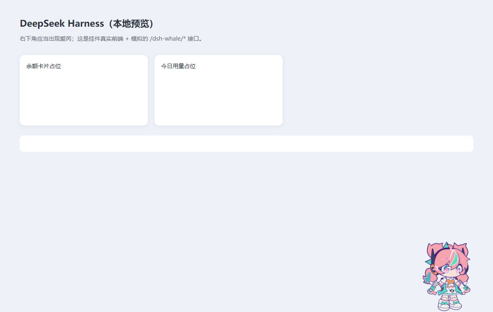
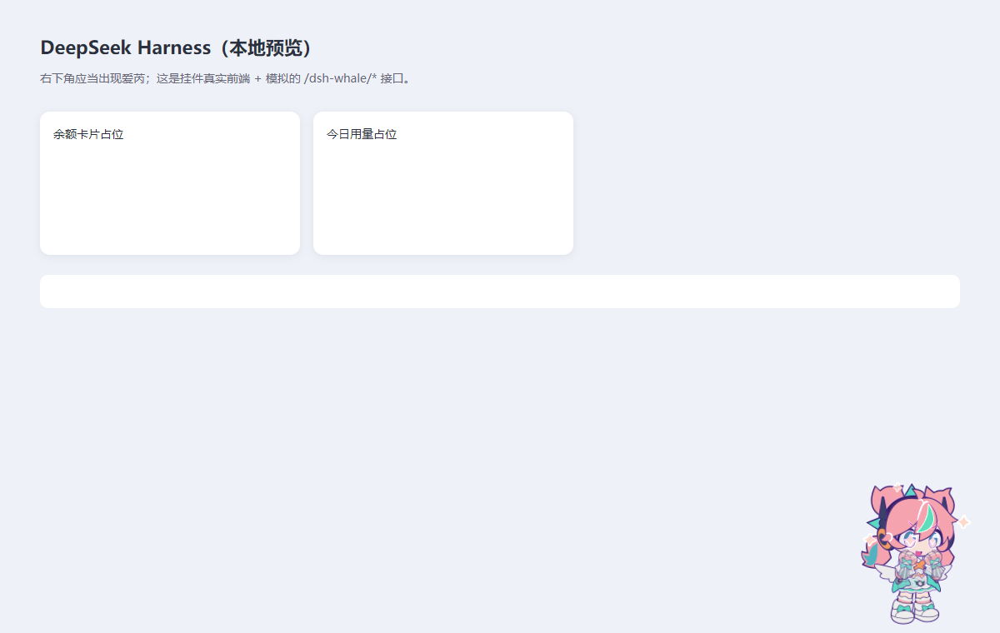

# 爱芮余额挂件（DSH）

> 把 [dsh-whale-widget](https://github.com/MeteorNOX/DeepSeek-Balance-Whale-Widget) 右下角的小鲸鱼，换成《绝区零》爱芮的**实时 Spine 骨骼动画**。
> 余额、今日已用、每轮消耗、泡泡编辑器、音效、吸附翻转——上游能力一个不少；小鲸鱼仍可随时切回。

> ⚠️ **非官方、非商业同人项目**：与米哈游 / HoYoverse、DeepSeek 均无隶属或合作关系，不提供商业授权。
> 角色与语音版权归米哈游 / COGNOSPHERE；语音不随仓库与公开安装包分发。
> 完整来源、许可与移除方式见 **[NOTICE.md](NOTICE.md)**；权利人可在 Issues 说明文件与依据，核实后会立即移除。



<p align="center"></p>

---

## 这是什么

一个 **DSH 插件**（bundle 包），基于 MIT 协议的 `dsh-whale-widget` 修改。差异只在「角色」这一层：

| | 上游小鲸鱼 | 本 fork |
|---|---|---|
| 形象 | 一张 610×610 透明 PNG | 爱芮 Spine 骨架（216 骨 / 25 动画 / 3 套皮肤） |
| 动画 | 静态图 + GIF | 实时 WebGL 渲染：待机循环、表情叠加、视线跟随 |
| 点击 | 弹余额泡泡 | 泡泡照旧 + 爱芮动作反馈 |
| 角色切换 | 自定义图片/动图 | 保留，并多一个内置「爱芮」 |

### 动画反馈

| 触发 | 动作 | 表情 | 台词 |
|---|---|---|---|
| 待机 | `动作_待机`（2.0s 循环） | `表情_常态` | — |
| 单击 | `动作_兴奋`（1.33s） | `表情_兴奋` | — |
| 双击 | `动作_自信`（1.67s） | `表情_自信` | — |
| 4 秒内连点 ≥6 次 | `动作_生气`（4.0s） | `表情_生气` | 「别戳了！再戳要生气了！」等 |
| 每轮消耗提示 | `动作_无奈`（2.0s） | `表情_无奈` | 「这一轮又花掉 X 元…」等 |
| 余额预警 | `动作_生气` | `表情_生气` | 「余额快见底了…」等 |
| 鼠标移动 | — | — | 眼球跟随光标（`眼部控制器` 骨） |

一眼看不出的实现细节：**命中判定没有重写**。canvas 只负责画面，原来那张 `` 仍在原位、只是变透明，继续提供逐像素凸包与 `clip-path`——所以贴边翻转、拖拽 Q 弹、气泡定位、透明处点击穿透，全部沿用上游行为。

---

## 安装（DSH 桌面客户端）

> 桌面端读的是 `desktop` profile，**不能用** `dsh plugin --profile web add`（CLI 会拒绝 `--profile desktop`，这是设计如此）。

### 方式 A：一键安装（推荐）

1. 下载本仓库（`Code → Download ZIP`，或 `git clone`）。
2. 双击 **`一键安装爱芮挂件.bat`**。
3. 等它自动完成：退出 DSH → 现场打包 → 安装登记 → **下载语音（约 173MB，可跳过）** → 启动 DSH。
4. 右下角出现爱芮即成功；没有就按一次 `Ctrl+F5`，或看下面「自检」。

> 不想下载语音：`powershell -ExecutionPolicy Bypass -File install-airui.ps1 -NoVoice`
>
> 也可以只跑命令（仓库根目录）：
> ```powershell
> powershell -NoProfile -ExecutionPolicy Bypass -File .\install-airui.ps1
> ```

### 方式 B：本地包 + 内置 plugin_manager

1. 用 `scripts\pack-public.ps1` 打一个**不含语音**的安装包（或直接用 Release 里的 `-public.tgz`）。
2. 在 DSH 会话里说：

   > 请使用当前桌面端内置的 `plugin_manager`，安装本机包
   > `file:<tgz 绝对路径>`。先核对 profile 是 `desktop`、是否已有同名插件；完成后告诉我结果和是否需要重启。

3. **完全退出客户端**（含系统托盘）再重新打开。
4. 语音可后补：`powershell -ExecutionPolicy Bypass -File scripts\fetch-voice.ps1 -TargetDir "%USERPROFILE%\.dsh\profiles\desktop\node_modules\dsh-whale-widget-airui\assets\zzz\voice"`

> 网页版（`dsh web`）：`dsh plugin --profile web add link:<解压目录绝对路径>`，重启后 `Ctrl+F5`。

### 自检

- 宿主半区：`%USERPROFILE%\.dsh\.dshw-turn.json` 是否生成、`seq` 是否随对话递增；
- 资源半区：浏览器/客户端里访问 `/dsh-whale/zzz/airui-idle.png` 应返回 200；
- 界面半区：菜单 →「角色」里应同时有「爱芮（LIVE）」和「小鲸鱼」。

### 卸载

用 `plugin_manager` 卸载 `dsh-whale-widget-airui`；或网页版执行
`dsh plugin --profile web remove dsh-whale-widget-airui`。
记账/泡泡/音效数据都在 `~/.dsh/.dshw-*.json`，卸载不会删除，重装即恢复。

---

## 开发与本地预览

不需要安装进 DSH 也能看效果（仓库根目录执行）：

```powershell
# 在仓库根目录（package.json 所在目录）执行
node dev/serve.mjs 8811
# 打开 http://127.0.0.1:8811/dev/widget.html
#   ?click=1  单击反应
#   ?click=6  连点生气
#   ?gaze=1   视线跟随
#   ?role=default 切回小鲸鱼
#   ?dbg=1    在页面上打印尺寸/相机/动画/视线调试信息
```

`dev/serve.mjs` 会模拟 `/dsh-whale/*` 的宿主接口，加载的是**真实的** `assets/whale-widget.js` 与爱芮渲染层。

自检（同样在仓库根目录）：

```powershell
node dev/check-zzz-assets.mjs   # 素材齐全 + Spine 数据可解析
node dev/host-selftest.mjs      # 用最小 Cordis 桩验证路由/角色表/注入行
```

---

## 目录结构

```text
plugin/
├── package.json            # dsh.bundle.patch → cordis.patch.yml
├── cordis.patch.yml        # 挂载声明
├── lib/index.js            # 宿主：余额/记账/全部路由 + /dsh-whale/zzz/* 白名单静态路由
├── assets/
│   ├── whale-widget.js     # 上游前端（仅新增角色/画布/点击钩子）
│   ├── zzz/
│   │   ├── pet.js          # 爱芮渲染层：Spine 加载、双轨动画、视线、台词、生命周期
│   │   ├── runtime/spine-webgl.min.js
│   │   ├── airui/          # airui.json / atlas / 两张图集
│   │   └── airui-idle.png  # 610×610 透明静帧（命中层 + 加载占位 + 降级图）
│   └── …                   # 上游小鲸鱼素材，全部保留
├── dev/                    # 本地预览与自检（不进安装包）
└── docs/                   # 预览图
```

运行时资源总计约 **3.0MB**（其中 spine-webgl 211KB、骨架数据 1.34MB、图集 1.42MB）。

---

## 素材与许可（**请先读**）

- **代码**：MIT。上游 Copyright © 2026 MeteorNOX；本 fork 的修改同样以 MIT 发布，保留上游 `LICENSE`。
- **爱芮角色素材**（Spine 骨架、图集、形象）：版权归**米哈游 / HoYoverse**，《绝区零》相关官方活动。数据取自非官方同人项目
  [HanaAyane/ZZZ-Idol-Desktop-Pet](https://github.com/HanaAyane/ZZZ-Idol-Desktop-Pet)，该项目明确声明
  **仅限个人学习、非商业展示与技术研究，不得出售/商业授权/打包销售，不得移除来源说明**。
  本仓库**不主张**对这些素材的任何版权，也不构成官方授权；如需公开分发，请自行评估并保留上述声明。
- **Spine 运行时**：`@esotericsoftware/spine-webgl` 4.2.42，遵循
  [Spine Runtimes License](assets/zzz/runtime/LICENSE.spine-runtimes)。按其条款，**每个使用者需自备 Spine Editor 授权**，再分发须附带该许可与版权声明。
- **上游小鲸鱼素材**：仍按上游 `PROVENANCE.md` 的说明使用，不在 MIT 覆盖范围内。

如果你只想自己用：保持私有即可。若要开源，请保留本节与 `PROVENANCE.md`，并把仓库声明为「非官方、非商业同人项目」。

---

## 语音

- 点击/双击/连点、每轮消耗、余额预警、充值、空闲（45–90 秒一次）都会播放对应的爱芮中文台词，并与「全部音效」总开关联动。
- **DSH 切到后台 / 最小化 / 失焦时自动静音**：已经开播的语音立即暂停，待机语音和事件语音都不再触发；回到前台后恢复。
- 语音**不随仓库和公开安装包分发**：`assets/zzz/voice/` 已加入 `.gitignore`。安装脚本默认会从公开数据集自动获取 13 条（约 173MB，来自 [Zenless Voice](https://huggingface.co/datasets/simon3000/zenless-voice) 的中文说话人 `Ariaidol`），不想下载可加 `-NoVoice`。
- 语音版权归**米哈游 / COGNOSPHERE**，仅供个人使用，**请勿再分发**；缺失时插件静默运行，不影响其他功能。
- 之后想补语音：`powershell -ExecutionPolicy Bypass -File scripts\fetch-voice.ps1`（可用 `-TargetDir` 指向已安装插件的 `assets\zzz\voice`）。

## 已知限制

- 实时渲染需要 WebGL。取不到 WebGL 时会**自动降级**为透明静帧（仍是爱芮，只是不动）。
- 桌面端安装需要完全重启客户端才会加载新 bundle；当前会话无法验证「装完立刻生效」，自检步骤见上。
- 爱芮的骨骼含物理约束，低端机上 60fps 会有占用；挂件隐藏（`display:none`）时会自动停止渲染。
- 语音：上游/桌宠仓库均无爱芮语音素材，本版沿用上游音效；台词以气泡形式呈现。

## 致谢

- [MeteorNOX/DeepSeek-Balance-Whale-Widget](https://github.com/MeteorNOX/DeepSeek-Balance-Whale-Widget)：整个挂件、记账与泡泡系统。
- [HanaAyane/ZZZ-Idol-Desktop-Pet](https://github.com/HanaAyane/ZZZ-Idol-Desktop-Pet)：爱芮 Spine 素材与双轨动画/视线实现思路。
- [Esoteric Software](https://esotericsoftware.com/)：Spine 运行时。
